<div align="center">


<br/>

<a href="https://github.com/FighterX-156">

</a>
<a href="https://www.linkedin.com/in/md-nafizur-rahman-seam-59228b377/">

</a>

<br/><br/>

**"First, solve the problem. Then, write the code."**

</div>

## `01` / ABOUT ME

```javascript
const seam = {
    name: "Md. Nafizur Rahman Seam",
    alias: "Siam",
    role: "CSE Student, Aspiring Full-Stack Developer & UI/UX Designer",
    university: "International Islamic University Chittagong",
    focus: [
        "Full-Stack Web Development",
        "UI/UX Design",
        "Data Structures & Algorithms"
    ],
    mindset: "Build useful things. Learn every day.",
    goal: "Turn ideas into real-world solutions."
};
```

- 🎓 Studying Computer Science and Engineering at IIUC.
- 🎨 Designing user-centered interfaces, from wireframes to polished prototypes.
- 💻 Developing my skills in modern web technologies.
- 🧠 Exploring problem-solving, algorithms and software design.
- 🛠️ Learning by building projects, not just collecting tutorials.

## `02` / TECH ARSENAL

<div align="center">

**Languages**


**Frontend**


**Backend & Database**


**Tools & Workflow**


</div>

## `03` / DESIGN TOOLKIT

<div align="center">


<br/><br/>


<br/><br/>

<code>Research</code> → <code>Wireframe</code> → <code>Prototype</code> → <code>Test</code> → <code>Ship</code>

</div>

## `04` / GITHUB STATISTICS

<div align="center">


<br/>


<br/>


</div>

## `05` / FEATURED PROJECTS

<div align="center">

<a href="https://github.com/FighterX-156/Portfolio-Website---By-Seam">

</a>
<a href="https://github.com/FighterX-156/Problem-Solving-with-Java">

</a>

<a href="https://github.com/FighterX-156/Store-Management-System-with-C-programming">

</a>
<a href="https://github.com/FighterX-156/Portfolio-PH">

</a>

<br/>

<sub>More projects coming soon. <a href="https://github.com/FighterX-156?tab=repositories">Explore all repositories →</a></sub>

</div>

## `06` / CURRENT MISSION

<div align="center">
  
</div>

## `07` / CONNECT WITH ME

<div align="center">

<a href="https://github.com/FighterX-156">

</a>
<a href="https://www.linkedin.com/in/md-nafizur-rahman-seam-59228b377/">

</a>

<br/><br/>


<br/><br/>

### KEEP BUILDING. KEEP EVOLVING.

<sub>Designed with curiosity, powered by code. © Seam</sub>


</div>